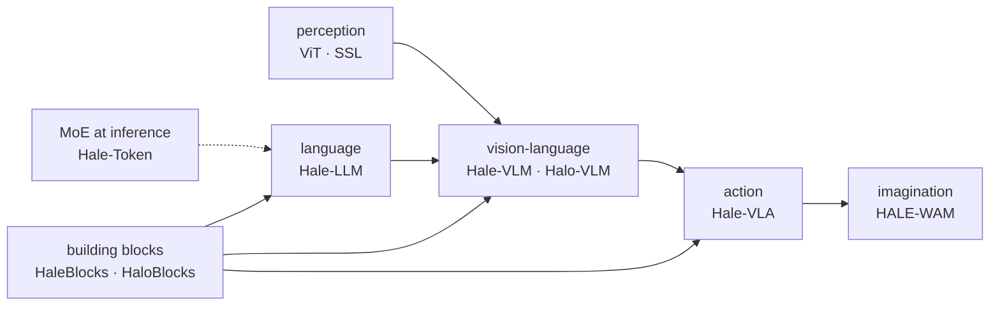

# From pixels to robot actions: a tour of the Hale/Halo ecosystem

*2026-09-28 · B A NaveenKumar*

> **Summary.** These notes sit alongside eight code repositories: two component
> libraries, a language-model testbed, an MoE inference engine for Macs, two VLM stacks, a
> VLA and a world-action model. This post walks the chain from perception to action, says
> which repo covers each link, and lists what I'd like each of them to answer next.

## 1. Building blocks

Everything starts with attention, feed-forward layers and masks, which research code tends
to rewrite for every project. **HaleBlocks** covers training code: registries and factories for attention, FFN
and MoE, and GPT, Gemma-3-style local–global and DiT stacks, plus strict configs and a
trainer (114 tests). **HaloBlocks** is the pip-installable sibling for model code: 37
blocks, from GQA and MLA to gated attention, which you can create by class, by name or
from a config dict (71 tests).

## 2. Language: four ways to write

**Hale-LLM** trains autoregressive, masked diffusion, block diffusion and flow-matching
language models on the *same* backbone and data. One of its clearest lessons comes from the maths rather than a plot: with a linear masking path, discrete flow matching and masked
diffusion are the same objective with time reversed.

## 3. Serving big MoE models on small machines

On the MoE side, **Hale-Token** is a Rust engine that keeps hot experts in a Mac's unified
memory and streams the rest from the SSD. It matches `transformers` logits to 1e-6, and its
first real run caught LRU thrashing under the cyclic layer order of decoding, which the
planner now avoids.

## 4. Vision-language: parameter-efficient vs. from scratch

**Hale-VLM** gives Qwen3-8B or DeepSeek-R1-Distill-7B eyes by training about 1% of the model
(SigLIP → MLP → LoRA), with the whole SmolVLM data recipe as a typed registry. **Halo-VLM**
puts that next to a 431M-parameter from-scratch ViT+MoE model and a one-token CLIP
baseline, so the three regimes can be compared on equal terms. Writing their papers turned
up a real bug (visual tokens overwriting the question text), now documented with a fix.

## 5. Action: one sequence, three special tokens

**Hale-VLA** reads images and robot state and writes text and action chunks through
`<image>`, `<state>` and `<action>` tokens in one MoE transformer. It is the from-scratch
counterpart to the π0.5 and SmolVLA notes: prepend for images, in-place injection for
state, and read-out for actions.

## 6. Imagination: a world-action model

**HALE-WAM** adds two heads to the VLA: a flow-matching action expert (the π0 idea) and a
DiT that predicts future frames from per-frame conditioning. At step 24,000 on a MoMa
episode it imagines the lamp going dark after "pull the chain". The frame is blurry and
over-contrasted, but the event is right.

## Open questions for each repo

| Repo | Question |
|---|---|
| Hale-VLA / Halo-VLM | do routed experts specialise by modality? |
| Hale-VLA | how much does an SSL-pretrained vision tower help a small VLA? |
| HALE-WAM | does predicting the future improve acting, or only explaining? |
| Hale-LLM | does block diffusion close the gap to AR at small scale? |
| Hale-Token | how skewed is real routing, and so how fast is SSD tiering in practice? |

Each repo now has a paper, a project page, Mermaid diagrams, a blog post and Claude Code
skills. The survey in this repo ([paper/](../../paper/main.tex)) ties them together, and
[errata.md](../errata.md) lists the citation fixes these notes still need.
