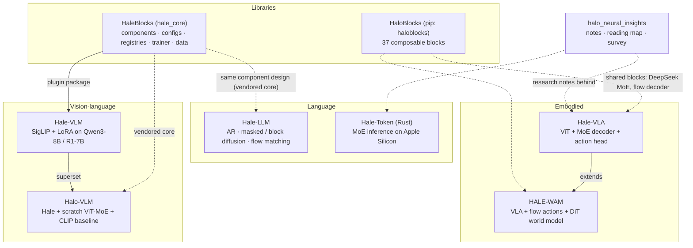

# The Hale / Halo ecosystem

Nine public repositories under
[basaanithanaveenkumar](https://github.com/basaanithanaveenkumar). The facts below were
checked against each repository's code in September 2026 (parameter counts measured by
instantiating the default configurations, and test counts from running the suites on CPU).

| Repo | What it is | Verified headline facts |
|---|---|---|
| [Hale-VLA](https://github.com/basaanithanaveenkumar/Hale-VLA) | from-scratch VLA: ViT, MoE decoder, state encoder, MLP action head; `<image>`/`<state>`/`<action>` tokens; EO-Data1.5M | 355.9M params (decoder ≈58M active/token) |
| [HALE-WAM](https://github.com/basaanithanaveenkumar/HALE-WAM) | VLA + flow-matching actions + DiT future-frame world model | 176.3M params; qualitative MoMa samples |
| [Hale-VLM](https://github.com/basaanithanaveenkumar/Hale-VLM) | SigLIP + MLP + LoRA on Qwen3-8B / DeepSeek-R1-Distill-7B; SmolVLM / SmolVLA registries | ≈83.5M / 71.6M trainable; 2 input-pipeline issues documented |
| [Halo-VLM](https://github.com/basaanithanaveenkumar/Halo-VLM) | Hale path + from-scratch HaloVLM (ViT-MoE) + BasicVLM (OpenCLIP) | HaloVLM 431.5M; tests 29 passed / 2 skipped |
| [HaleBlocks](https://github.com/basaanithanaveenkumar/HaleBlocks) | shared components, strict configs, registries, trainer, SmolLM2/VLM data | 114 tests pass |
| [HaloBlocks](https://github.com/basaanithanaveenkumar/HaloBlocks) | pip-published composable blocks (attention zoo, MoE, builder) | 37 blocks; 71 tests pass |
| [Hale-LLM](https://github.com/basaanithanaveenkumar/Hale-LLM) | AR vs masked diffusion vs block diffusion vs flow matching on one backbone | 47.7M (AR) / 63.2M (LGT); 53 unit tests pass, 3 stale imports |
| [Hale-Token](https://github.com/basaanithanaveenkumar/Hale-Token) | Rust MoE engine tiering experts across unified memory and SSD | logits match `transformers` (rel. RMS 1.2e-6); 49 unit + integration tests pass |
| halo_neural_insights | this knowledge base | — |

Every repository now has an arXiv-style paper in `paper/`, a GitHub Pages project page
in `project-page/`, Mermaid architecture diagrams in `docs/`, a blog post, and Claude Code
skills in `.claude/skills/`.
