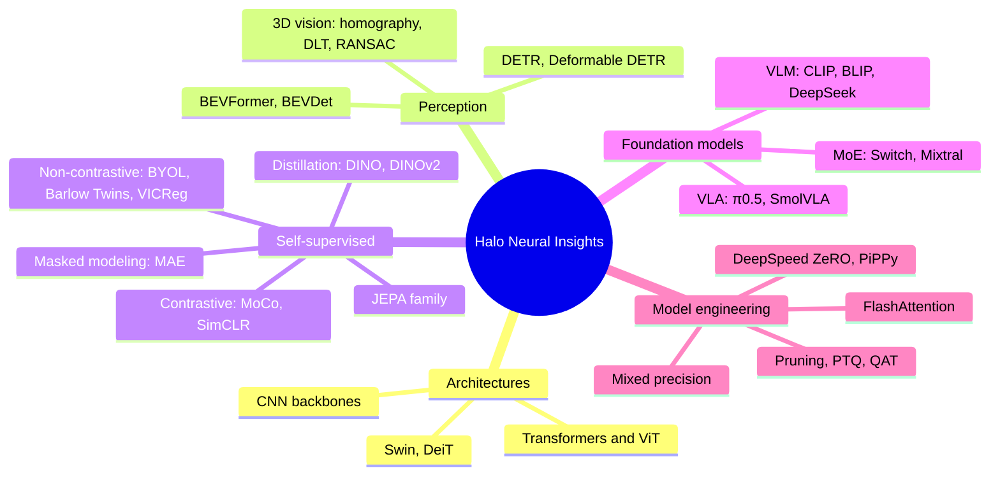
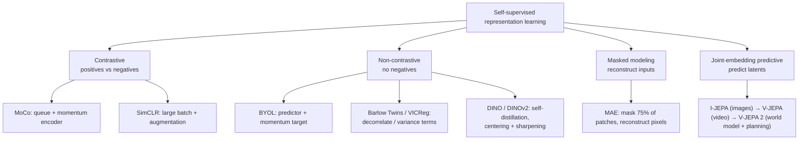
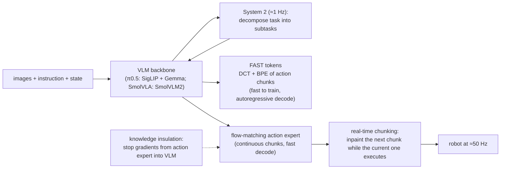
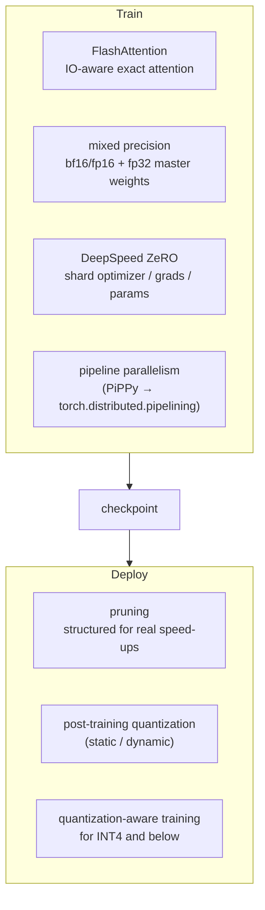

# Reading map

## 1. Topics in this knowledge base

## 2. Self-supervised learning: how the families avoid collapse

## 3. VLA design space (from the π0.5 and SmolVLA notes)

## 4. Efficiency stack (from the model-engineering notes)

